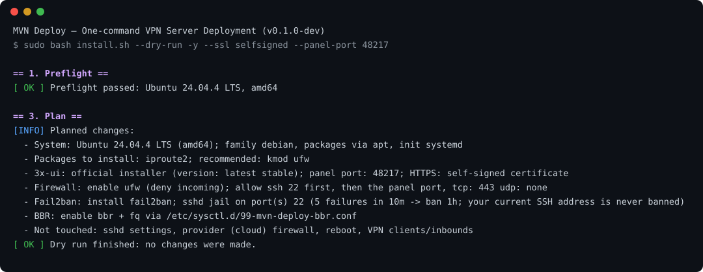

<div align="center">

# MVN Deploy

**Одна команда превращает чистый VPS в готовый VPN-сервер на официальной 3x-ui.**

[](https://github.com/sernekrasov2009-lang/mvn-deploy/actions/workflows/ci.yml)


[](https://github.com/sernekrasov2009-lang/mvn-deploy/releases)
[](https://github.com/sernekrasov2009-lang/mvn-deploy/stargazers)

[Установка](#установка) · [Команда mvn-deploy](#команда-mvn-deploy) · [Совместимость](#совместимость) · [Параметры](#параметры) · [Как это работает](#как-это-работает) · [Безопасность](#безопасность) · [FAQ](#faq)

</div>

---

MVN Deploy устанавливает **официальную панель [3x-ui](https://github.com/MHSanaei/3x-ui)** (она управляет Xray-core),
включает HTTPS, firewall, защиту SSH и TCP BBR, проверяет результат и печатает адрес панели.
Inbound-ы и клиентов вы создаёте уже в веб-интерфейсе панели.

> **Статус: `0.1.0-dev`.** Установка на Debian/Ubuntu проверяется автоматически на реальных машинах в CI
> (см. [Совместимость](#совместимость)). Остальные семейства дистрибутивов реализованы и проверяются
> «сухим» прогоном, но ещё не прошли полную установку на живом сервере.

<div align="center">

<br><sub>Фрагмент настоящего вывода <code>--dry-run</code>: план изменений, сервер при этом не меняется.</sub>
</div>

## Возможности

| | |
|---|---|
| **3x-ui** | Только официальный установщик 3x-ui; пароль панели не попадает в общий лог |
| **HTTPS панели** | Let's Encrypt для IP-адреса или домена; если сертификат не выдан, автоматически самоподписанный. Адрес панели определяется по её реальному ответу |
| **Порт панели** | Свой порт или случайный; конфликты с SSH, портом 80 и занятыми портами отсекаются |
| **Firewall** | UFW (Debian/Ubuntu/Arch/Alpine) или firewalld (RHEL-семейство, openSUSE). SSH разрешается **до** включения, чужие правила не сбрасываются |
| **Fail2ban** | Защита SSH от подбора пароля; ваш текущий адрес никогда не банится; свой jail не перезаписывается |
| **BBR** | TCP BBR + fq только если его поддерживает ядро |
| **Много дистрибутивов** | Debian, Ubuntu, AlmaLinux, Rocky, RHEL, Oracle, CentOS Stream, Fedora, Amazon Linux, Arch, openSUSE, Alpine |
| **Устойчивость** | Повторы при сетевых сбоях, починка прерванного `dpkg`, понятные подсказки, откат firewall при проблемах |
| **Команда `mvn-deploy`** | `doctor` (диагностика), `status`, `backup` / `restore`, `update`, `uninstall` |
| **Конфиг одним файлом** | YAML (`config/example.yml`): одинаковые серверы без вопросов |
| **Безопасно по умолчанию** | `--dry-run` ничего не меняет; повторный запуск идемпотентен; `uninstall.sh` удаляет только своё |

## Установка

Нужны root-права и доступ к GitHub с сервера.

**Интерактивно** (спросит порт панели и вид HTTPS):

```bash
curl -fsSL https://raw.githubusercontent.com/sernekrasov2009-lang/mvn-deploy/main/install.sh -o /tmp/mvn-deploy-install.sh \
  && sudo MVN_ALLOW_DEV=1 bash /tmp/mvn-deploy-install.sh
```

**Без вопросов** (`-y`): случайный порт панели, HTTPS автоматически, порт 443 открыт под ваш inbound:

```bash
sudo MVN_ALLOW_DEV=1 MVN_EXTRA_TCP_PORTS=443 bash /tmp/mvn-deploy-install.sh -y
```

**С доменом и своим портом** (A-запись домена уже должна указывать на сервер):

```bash
sudo MVN_ALLOW_DEV=1 MVN_EXTRA_TCP_PORTS=443 bash /tmp/mvn-deploy-install.sh -y \
  --domain vpn.example.com --panel-port 54321
```

Сначала можно добавить `--dry-run`: скрипт покажет план и ничего не изменит.

> Пока нет подписанного релиза, установка идёт из ветки `main` (поэтому `MVN_ALLOW_DEV=1`).
> Релизы с проверкой SHA-256 появятся после первых успешных установок на реальных серверах.
> **Alpine:** сначала `apk add bash curl`, у Alpine нет bash по умолчанию.

После установки в конце выводится адрес панели; логин и пароль лежат в `/etc/x-ui/install-result.env` (только root).
Дальше создайте inbound в панели и откройте его порт в firewall (`ufw allow <порт>/tcp` или `firewall-cmd --permanent --add-port=<порт>/tcp && firewall-cmd --reload`).

## Команда mvn-deploy

После установки доступна команда `mvn-deploy` (не `mvn`: это имя занято Apache Maven).

| Команда | Что делает |
|---|---|
| `mvn-deploy doctor` | диагностика сервера только на чтение: система, сеть, служба и порт панели, срок сертификата, firewall, fail2ban, BBR, конфликты. Код выхода 1, если что-то сломано |
| `mvn-deploy status` | короткая сводка: адрес панели, службы, firewall, последняя резервная копия |
| `mvn-deploy backup` | архив базы панели, сертификатов и настроек (права 600, хранится 10 последних) |
| `mvn-deploy restore ФАЙЛ` | восстановление; архив проверяется (только свои пути, без ссылок и `..`), перед заменой делается копия текущего состояния |
| `mvn-deploy update` | обновить сам MVN Deploy; перед этим делается копия данных панели |
| `mvn-deploy uninstall` | убрать только созданное MVN Deploy |

Конфигурация одним файлом (без вопросов при установке): [docs/CONFIG.md](docs/CONFIG.md), пример `config/example.yml`:

```bash
sudo bash install.sh -y --config deploy.yml
```

## Совместимость

Список опирается на дистрибутивы, которые поддерживает сам установщик 3x-ui.

| Семейство | Дистрибутивы | Минимум | Пакеты | Firewall | Проверка |
|---|---|---|---|---|---|
| Debian | Debian, Ubuntu, Armbian и производные (Mint, Kali, Pop!_OS…) | Debian 12, Ubuntu 20.04 | apt | UFW | **Полная установка в CI**: Ubuntu 22.04 и 24.04; dry-run: Debian 12–13, Ubuntu 20.04–24.04 |
| RHEL | AlmaLinux, Rocky, RHEL, Oracle Linux, CentOS Stream, Fedora, Amazon Linux | 8 / Fedora 39 / AL2023 | dnf, yum | firewalld | Dry-run в CI |
| Arch | Arch Linux, Manjaro | rolling | pacman | UFW | Dry-run в CI (Arch) |
| SUSE | openSUSE Leap, Tumbleweed | Leap 15.5 | zypper | firewalld | Dry-run в CI |
| Alpine | Alpine Linux (OpenRC) | 3.18 | apk | UFW | Dry-run в CI, **экспериментально** |

Архитектуры: `amd64`, `arm64` (основные), `armv7`, `armv6`, `armv5`, `386`, `s390x` (поддерживает 3x-ui, у нас не тестируются).
Устаревшие и неизвестные системы (CentOS 7, Ubuntu 18.04, Debian 10/11…) отклоняются; принудительно: `MVN_ALLOW_UNSUPPORTED_OS=1`.
Подробнее: [docs/COMPATIBILITY.md](docs/COMPATIBILITY.md).

## Параметры

Флаги командной строки:

| Флаг | Значение |
|---|---|
| `-y`, `--yes` | не задавать вопросов; в сомнительных ситуациях остановиться |
| `--dry-run` | показать план, ничего не менять |
| `--panel-port N` | порт панели 3x-ui |
| `--ssl РЕЖИМ` | `auto` · `ip` · `domain` · `selfsigned` · `none` |
| `--domain ИМЯ` | домен для сертификата Let's Encrypt |
| `--ref ТЕГ` | версия MVN Deploy |

Основные переменные окружения (или строки `MVN_ИМЯ=значение` в `/etc/mvn-deploy/mvn-deploy.conf`):

| Переменная | По умолчанию | Описание |
|---|---|---|
| `MVN_EXTRA_TCP_PORTS` / `MVN_EXTRA_UDP_PORTS` | пусто | порты под ваши inbound-ы (`443`, `443,8443`, `10000:10100`) |
| `MVN_SSH_PORTS` | авто | дополнительные SSH-порты |
| `MVN_FIREWALL` | `auto` | `skip` отключает управление firewall |
| `MVN_FAIL2BAN` | `auto` | `skip` отключает fail2ban |
| `MVN_BBR` | `auto` | `skip` отключает BBR |
| `MVN_XUI_SSL_FALLBACK` | `selfsigned` | что делать, если Let's Encrypt не выдал сертификат (`none` = HTTP) |
| `MVN_XUI_VERSION` | последняя | версия 3x-ui, например `v3.7.0` |
| `MVN_PKG_UPGRADE` | `0` | `1` = ещё и полное обновление пакетов |
| `MVN_ALLOW_CONFLICTS` | `0` | продолжать при найденных xray/sing-box и т. п. |
| `MVN_ALLOW_UNSUPPORTED_OS` | `0` | попробовать на неподдерживаемой системе (на свой риск) |

Полный список: [docs/INSTALL.md](docs/INSTALL.md).

## Как это работает

```
1 Проверки   ОС, архитектура, init, диск, время, сеть, память, контейнер
2 Инвентарь  SSH-порты, firewall, найденный 3x-ui и конфликтующие службы
3 План       вопросы (если интерактивно) и список изменений; --dry-run останавливается здесь
4 Пакеты     только недостающее, через родной пакетный менеджер
5 Подготовка права и каталоги MVN Deploy
6 3x-ui      официальный установщик, проверка HTTPS, запасной сертификат
7 Firewall   SSH, порт панели, ваши порты; затем включение и проверка доступа
8 Fail2ban   jail sshd одним файлом
9 BBR        sysctl + модуль, если поддерживается ядром
10 Проверка  служба, порты, firewall, BBR, права файлов
11 Отчёт     адрес панели, предупреждения, что делать дальше
```

Если что-то необязательное не получилось (firewall в контейнере, fail2ban недоступен в репозитории,
BBR не поддерживается ядром), установка не прерывается: проблема попадает в предупреждения итогового отчёта.

## Безопасность

- SSH разрешается в firewall **до** его включения; после включения доступ проверяется, при проблеме firewall выключается обратно.
- Ваш текущий SSH-адрес добавляется в исключения fail2ban, заблокировать себя нельзя.
- Пароли и токены не пишутся в общий лог; файлы состояния доступны только root.
- Каталоги, удаляемые скриптами, проверяются (`rm -rf` не выполнится на `/usr` и подобных путях).
- Чужой firewall (nftables/iptables/Docker) не трогается; в режиме `-y` скрипт остановится и попросит явное решение.
- Fail2ban защищает SSH, но не вход в панель: для панели используйте HTTPS и длинный случайный путь (создаётся установщиком 3x-ui).

Подробности: [docs/SECURITY.md](docs/SECURITY.md).

## Обновление и удаление

```bash
sudo bash /opt/mvn-deploy/update.sh --ref v1.0.0    # обновить сам MVN Deploy (3x-ui и данные не трогает)
sudo bash /opt/mvn-deploy/uninstall.sh              # убрать только то, что создал MVN Deploy
sudo bash /opt/mvn-deploy/uninstall.sh --backup-xui # плюс резервная копия данных 3x-ui
```

`uninstall.sh` никогда не удаляет 3x-ui, её базу и правила SSH.

## FAQ

**Заработает ли VPN сразу после установки?** Панель, HTTPS, firewall и BBR готовы. Сам VPN появляется, когда вы создадите inbound и клиента в панели и откроете его порт.

**Почему `-y` остановился с вопросом про firewall?** Найден чужой firewall (например, Docker добавляет правила iptables). Решите явно: `MVN_FIREWALL=skip` или настройте порты сами.

**Браузер ругается на сертификат.** Значит, Let's Encrypt не выдал сертификат (закрыт порт 80, DNS домена не указывает на сервер) и применён самоподписанный. Это нормально: примите его один раз или используйте домен.

**Что-то пошло не так.** Журнал: `/var/log/mvn-deploy/install.log`. Типичные проблемы и решения: [docs/TROUBLESHOOTING.md](docs/TROUBLESHOOTING.md).

## Структура проекта

```
install.sh  update.sh  uninstall.sh         точки входа
bin/mvn-deploy                               команда mvn-deploy (doctor, backup, ...)
config/     defaults.conf example.yml        значения по умолчанию и пример YAML
scripts/    platform system dependencies security panel_tls three_x_ui
            firewall fail2ban bbr verify backup doctor cli logger common
docs/       INSTALL CONFIG ARCHITECTURE COMPATIBILITY TROUBLESHOOTING SECURITY MIGRATION SPECIFICATION
tests/      lint.sh unit.sh               tools/make-release.sh
.github/workflows/ci.yml                     lint, dry-run на 16 образах, реальная установка на Ubuntu
```

## Разработка

```bash
bash tests/lint.sh                   # bash -n, ShellCheck, shfmt, поиск секретов, unit-тесты
bash tools/make-release.sh v1.0.0    # dist/*.tar.gz + .sha256 для релиза
```

Правила и шаблоны: [CONTRIBUTING.md](CONTRIBUTING.md), устройство проекта: [docs/ARCHITECTURE.md](docs/ARCHITECTURE.md), безопасность: [SECURITY.md](SECURITY.md).
Полную установку проверяйте на временном сервере. CI делает это автоматически на Ubuntu 22.04 и 24.04.

## Лицензия

[MIT](LICENSE)
